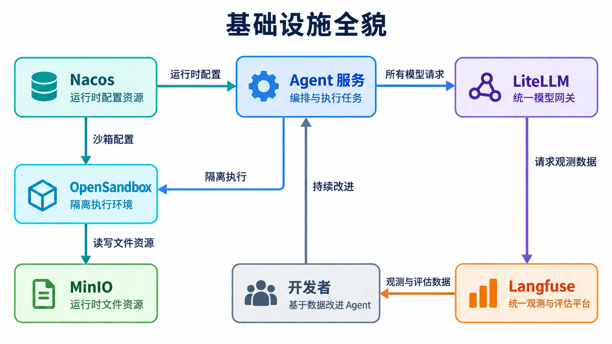

# 本地AI Agent一体化开发基建

一套面向AI应用开发的本地工程化环境，解决Agent开发过程中模型路由分散、执行环境不安全、请求链路无观测、配置硬编码的共性问题。


## 核心能力

✅ LiteLLM 统一模型网关：屏蔽多平台大模型API差异，实现跨渠道额度自动轮询、故障降级兜底
✅ Nacos 运行时配置中心：统一管理Agent任务参数、模型路由规则，避免硬编码
✅ OpenSandbox 隔离执行环境：Agent代码在沙箱内运行，不污染本地环境
✅ MinIO 对象存储：持久化任务过程中的文件资源
✅ Langfuse 全链路观测：追踪每一次模型调用、评估Agent输出质量，支撑持续迭代

## 启动服务

**启动基础设施环境**

```shell
make docker-recreate
```

**启动Agent服务**

```shell
# 开发模式
make dev
# debug模式
make debug
```

## 服务说明

### 常用服务

- **Agent服务**

  API访问地址：http://localhost

  langsmith调试地址：https://smith.langchain.com/studio/?baseUrl=http://127.0.0.1:80

- **Langfuse 管理后台**

  访问地址： http://localhost:3000

- **LiteLLM**

  管理后台：http://localhost:4000/ui/

  账号：admin

  密码：123456

  API 地址：http://localhost:4000/v1

- **Nacos 管理后台**

  访问地址：http://localhost:8080/

  账号：nacos

  密码：初始界面自行设定

  API接口文档：https://nacos.io/swagger/client/

- **OpenSandbox Server**

  API 接口：http://127.0.0.1:8090/docs

- **Shared MinIO（共享对象存储）**

  管理后台：http://localhost:9003

  账号：root

  密码：12345678

  宿主机访问 API：http://localhost:9002

### 不常用服务

- Langfuse MinIO 管理后台

  访问地址： http://localhost:9001

  账号：root

  密码：12345678
